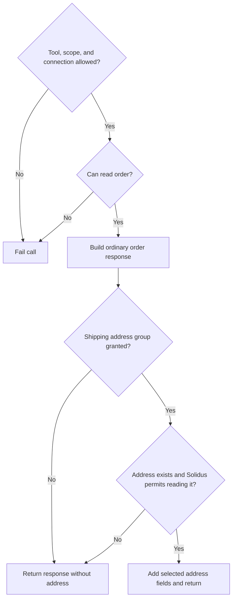

# Data access groups

Deferred design, retained for reference. Data groups are not part of the current
serializer feature and the APIs and database changes below are not implemented.
Revisit this if stores need different data access for different connections to
the same tool. For now, use serializer hooks, Solidus record abilities, and
separate custom tools when independent MCP grants are needed.

The goal is to control sensitive information without asking administrators to
approve every field separately. Keep tool grants for what a connection can do,
then add a short list of data groups for what else it can receive.

[Open the interactive permission preview](data-access-preview.html).

## What an administrator would see

The existing tool table stays in place. Below it, a **Data access** section shows
two optional groups for orders:

| Group | Allows | Does not allow |
| --- | --- | --- |
| Customer contact | Order email and shipping contact phone, when present and accessible. | Postal addresses, staff notes, or payment credentials. |
| Shipping address | Recipient name, company, street, city, region, postal code, and country. | Email, phone, billing addresses, or payment credentials. |

Order number, totals, states, and the existing bounded line items remain part of
the ordinary tools. There is no extra "Order details" checkbox to duplicate the
tool grant. Enabling a data group alone does not enable a tool.

Groups apply to one OAuth application/user connection, just like tool grants.
They are not global user roles and are not checked separately for each tool.
The initial built-in consumers would be `get_order` and `search_orders`.
`get_order_status` and write responses would retain their current formats.

Keep data groups separate from the tool table's **Select all permissions**.
For the first version, do not add a data-group select-all control or role presets.
Show a description under each group so administrators know what they are allowing.
Existing hierarchy rules still govern who can edit the connection; users see
their own grants read-only.

## What comes back

Assume `get_order` is enabled and the user can read the order:

| Data grants | Solidus address access | Result |
| --- | --- | --- |
| None | Allowed | Existing order fields only. |
| Customer contact | Allowed | Order fields, email, and shipping phone when available. |
| Customer contact | Denied | Order fields and email; omit shipping phone. |
| Shipping address | Allowed | Order fields and shipping address, without email or phone. |
| Shipping address | Denied | Order fields; omit shipping address. |
| Both | Allowed | Order fields, contact information, and shipping address. |

An absent address and an inaccessible address both cause the optional address
fields to be omitted. Do not return a list of denied fields or explain which
private record exists. Clients must treat omitted fields as unavailable.

If the tool grant, OAuth scope, or primary order authorization fails, the call
still fails. Optional omissions only apply after those checks succeed.



## Serializer interface

Add a non-raising group check beside the existing record check:

```ruby
context.data_allowed?('orders.shipping_address') # Proposed MCP connection check
context.can?(:read, address)                    # Existing Solidus record check
```

For example, a custom order serializer could return a subset of the fields a
group allows:

```ruby
module Mcp
  class OrderSerializer
    def self.call(order, context:)
      result = {number: order.number, total: order.total.to_s('F')}

      if context.data_allowed?('orders.customer_contact')
        result[:customer_contact] = {email: order.email}
      end

      if context.data_allowed?('orders.shipping_address')
        address = order.ship_address
        if context.can?(:read, address)
          result[:shipping_address] = {
            recipient: [address.firstname, address.lastname].compact.join(' '),
            city: address.city,
            postal_code: address.zipcode
          }
        end
      end

      result
    end
  end
end
```

Check the group before accessing the related record. When including a phone
from `order.ship_address` under Customer contact, check access to that address
record too. A group can authorize a field without authorizing every other field
on the same record.

Keep `authorize_record!` for related records that are essential to a tool's
purpose. A dedicated address-retrieval tool could require both checks and fail
when either is denied. Whole-tool data requirements are a possible follow-up;
the first version only needs optional response groups.

Alba and other libraries receive the same context through the adapter's params.
Their conditional fields or associations can call these helpers. The gem should
not require a particular serialization library or try to infer permission groups
from arbitrary output field names.

Custom serializers remain trusted Ruby code. The gem checks the primary record
and enforces its own serializers, but cannot prevent host code from returning
`order.email` without using a group check. Requiring callers to register every
output path would be a different, more restrictive serialization design.

## Group definitions

Register the two built-in groups automatically. Let stores add named groups in
trusted application configuration, not through an MCP tool or the admin UI:

```ruby
# Proposed configuration; not available in the prototype yet.
config.custom_data_groups = [
  {
    key: 'store.product_costs',
    name: 'Product costs',
    description: 'Variant cost amounts and cost currencies.'
  }
]
```

Keep definitions separate from grants. A definition makes the option available;
only an authorized administrator can grant it to a connection. Reject duplicate
keys, collisions with built-ins, invalid keys, and missing descriptions.

Groups describe a bounded kind of information, not individual columns. Adding
another representation of the same approved information need not create a new
checkbox. Expanding Customer contact to include purchase history would broaden
its meaning and needs a new group key. Never reuse a retired key for another
purpose. Documentation and UI descriptions must match the actual fields exposed.

## Stored grants and enforcement

Add `data_permissions`, a non-null JSONB array defaulting to `[]`, to the existing
`solidus_mcp_connection_policies` table. Keep it separate from `permissions`,
which continues to contain tool keys.

```ruby
{
  permissions: ['get_order', 'search_orders'],
  data_permissions: ['orders.shipping_address']
}
```

Use the existing policy row, owner checks, transaction, `lock_version`, and audit
table. Audit tool and data grants together in `previous_values` and `new_values`.
Older audit entries with no `data_permissions` key represent no data grants.

Extend `ConnectionPolicy#change!` with an optional data-grants argument. Older
callers that omit it should preserve the current data grants. New forms submit
an explicit empty array when clearing them. Deleting a permission set clears
both grant lists and disables the connection; restoration requires explicit
grants again.

`data_allowed?` returns true only if:

1. The credential is still active and belongs to a Solidus administrator.
2. The connection is enabled and not deleted.
3. The token includes `mcp:read`.
4. The group is currently registered.
5. The connection explicitly holds that group key.

The tool still needs its own grant, scopes, and record checks. A data group never
authorizes mutations. Unknown, removed, and ungranted groups return false.
Retired grants can remain in historical records without granting live access.

Resolve group definitions during Rails prepare, like the tool catalog. Do not
keep grants in tokens or a process-wide cache. Reused server/policy instances
must refresh authorization for each tool execution so revocation takes effect on
subsequent calls. Avoid one database lookup per serialized record by using an
execution-scoped grant snapshot, cleared when a new tool call is authorized.

## OAuth and existing connections

For the first version, keep the existing `mcp:read` and `mcp:write` scopes. Data
groups are a narrower administrative control within read access, not an OAuth
scope for each group.

Update consent wording to explain that read access can include customer contact
and delivery information when an administrator grants those groups. Under this
model, an existing read token could receive a newly granted group without another
OAuth flow. That is an explicit design choice, consistent with administrators
enabling additional read tools within existing consent.

If we want separate user consent for personal information, add one broader OAuth
scope for customer data later, rather than a scope for every group. That would
require reauthorization as well as a group grant. Decide this before shipping the
group feature; the preview assumes the simpler existing-scope model.

Existing connections migrate with empty data grants and retain their current
tool grants. New groups are never automatically enabled, including when all
existing tool permissions were selected. Existing custom serializers must adopt
the group checks to participate; this migration cannot restrict arbitrary host
Ruby code retroactively.

## Implementation order

1. Group catalog and explicit connection grants, with audits and revocation tests.
2. `data_allowed?`, preserving required-record failures and optional omissions.
3. Two optional groups in built-in order serialization, using explicit field lists.
4. A separate admin Data access section, respecting the current hierarchy.
5. Plain Ruby and Alba examples, consent wording, and upgrade instructions.

Test the complete matrix of group grants and Solidus record abilities, expired
or revoked tokens, disabled/deleted connections, unknown and retired groups,
stale forms, role changes, token refresh, and cached/reused tool execution.
Assert that addresses cannot leak through Customer contact, phones cannot leak
through Shipping address, and custom field names do not affect group checks.

For now, defer per-field grants, group editing in the admin UI, per-tool copies of
the same data grant, and configurable access-profile presets.
